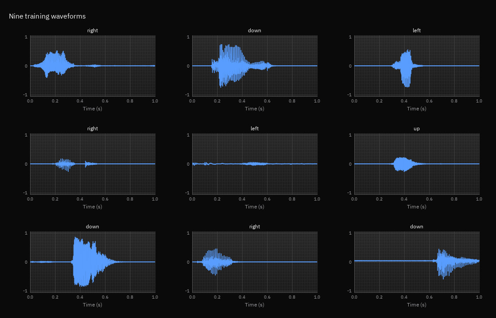
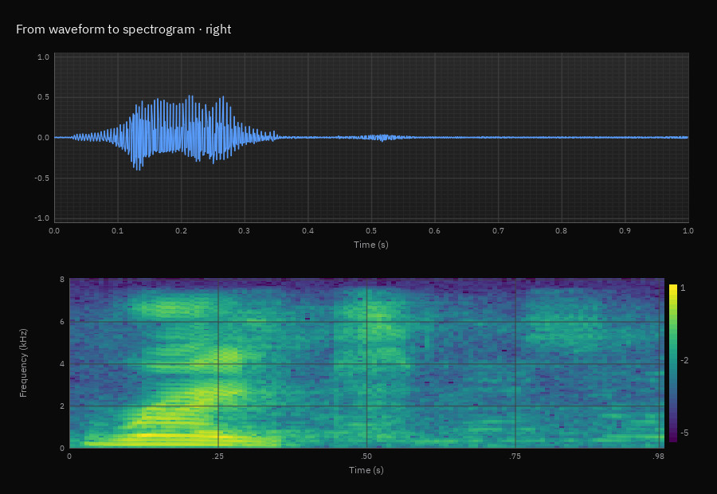
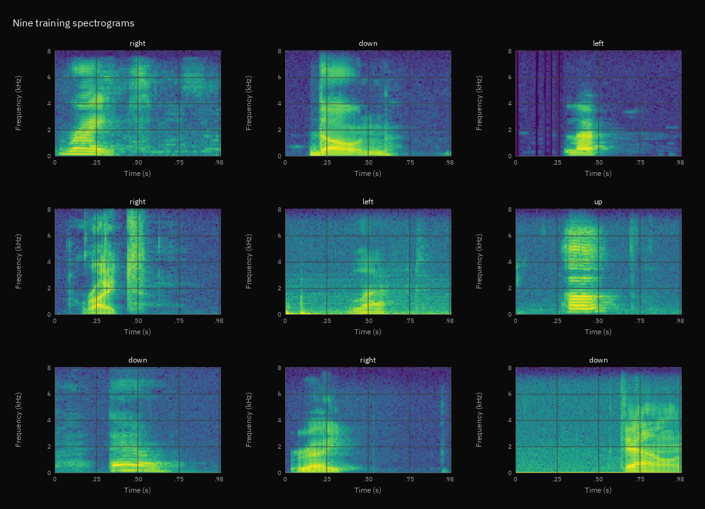
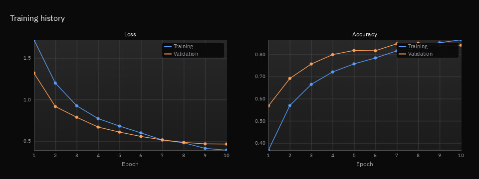
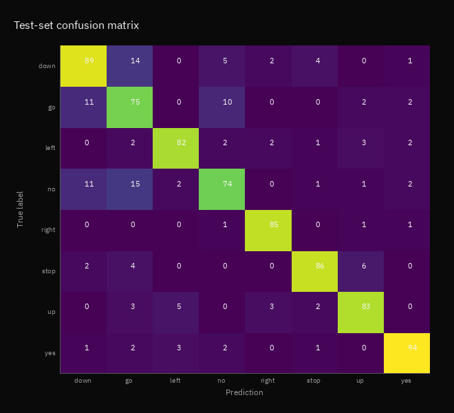
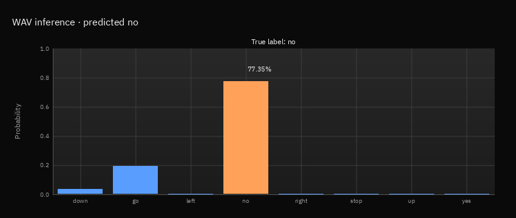

# Recognize speech commands in Python

Train a CNN to recognize eight spoken commands. This walkthrough follows the
[TensorFlow simple audio tutorial](https://www.tensorflow.org/tutorials/audio/simple_audio)
using OA for signal processing and training and OADS for the complete 8,000-clip
mini Speech Commands pack used in that tutorial.

## Run in Python

Run from the OASDK root.

```sh
python -m pip install oapython==0.18.0 oadspython==0.5.0
python src/py/tutorials/ml/tu_ml_audio_commands/tu_ml_audio_commands.py
```

The default schedule uses up to ten epochs and 64 clips per batch.
Set `OA_DATA_DIR` to share the OADS cache. Use `--preview-only` for waveform
and spectrogram inspection or `--steps 32 --batch 8` for a short replay check.
Select a specific Vulkan device with `--device INDEX`.

## 1. Load and inspect the audio

OADS verifies and loads every recording in the mini pack. It scales PCM to
`[-1, 1]` and pads each mono 16 kHz clip to 16,000 samples. Each command has
1,000 examples. The class IDs are `down`, `go`, `left`, `no`, `right`,
`stop`, `up`, and `yes`.

```python
data = MiniSpeechCommands.load(runtime, progress=False)
print(data.samples.shape, data.labels.shape)
```

The input and label shapes are `[8000, 1, 16000]` and `[8000]`. Both
programs use OA's seed-42 shuffle to reserve 6,400 clips for training, 800
for validation, and 800 for the final test. This gives matching Rust and
Python splits with the same proportions as the reference. The TensorFlow
loader uses its own file order and shuffle.



[Play clip 1](asset/clip_1.wav)

[Play clip 2](asset/clip_2.wav)

[Play clip 3](asset/clip_3.wav)

## 2. Convert waveforms to spectrograms

A short-time Fourier transform measures how a clip's frequency content
changes over time. Apply a periodic Hann window to 255 samples, advance by
128 samples and use a 256-point FFT. OA returns the magnitudes of 129
nonnegative-frequency bins in 124 frames. Add a channel axis so the CNN
receives `[batch, 1, 124, 129]` in OA's channel-first layout.

```python
magnitude = audio.stft(fft_size=256, hop_size=128, win_size=255, center=False)
features = magnitude.reshape([batch, 1, 124, 129])
```



The frequency plots use log magnitude to make quiet components easier to
spot. The CNN receives linear magnitudes.



## 3. Build the classifier

Fit a scalar mean and standard deviation on the training spectrograms.
Bilinearly resize each spectrogram to 32×32, then apply the fitted statistics
to training, validation, test and inference inputs. The tutorial caches the
resized features before training, so replay reuses the prepared batch shape.

| Layer | Output per clip |
| --- | --- |
| Bilinear resize and normalization | 1 × 32 × 32 |
| 3×3 convolution, ReLU | 32 × 30 × 30 |
| 3×3 convolution, ReLU | 64 × 28 × 28 |
| 2×2 max pooling and Dropout(0.25) | 64 × 14 × 14 |
| Flatten and dense ReLU | 128 |
| Dropout(0.5) and dense | 8 logits |

The model has 1,625,608 trainable values. The output logits go into sparse
cross-entropy. AdamW uses zero weight decay and the reference Adam settings
with a learning rate of 0.001 and epsilon of `1e-7`.

## 4. Train with compiled replay

`ItTraining` owns the optimizer updates, loss metric, progress bar, and
summary. The prepare callback uploads fresh data and integer labels. The
record callback builds the forward and backward pass. OA warms up eagerly,
captures a fixed-shape update, and replays the compiled step with new data.
The programs verify cached replay, a zero fallback count, and agreement
between completed steps and optimizer updates.

```python
def record(prepared):
    input_matrix, target = prepared
    with oa.ml.GradientTape() as tape:
        logits = model.forward(input_matrix)
        loss = oa.ml.loss.cross_entropy(logits, target)
        tape.backward(loss)
    return loss
```

After each epoch, switch dropout off and evaluate the validation split.
Return to training mode for the next epoch. Stop after two consecutive epochs
without a lower validation loss, as in the reference.

The figures below come from the Python run on Mesa llvmpipe. It completed 1,000
updates across 10 epochs with 64 clips per batch. Validation and test each
used all 800 clips in their respective splits.

```text
Split: 6400 train · 800 validation · 800 test

epoch 1/10
  100/100 |██████████| 610.00s · 6100.04 ms/step · 10 sample/s · 10 clip/s · loss: 1.4723
  100/100 — 610.0s 6100 ms/step · accuracy: 0.3678 · loss: 1.7195 · val_accuracy: 0.5675 · val_loss: 1.3192

epoch 2/10
  100/100 |██████████| 604.72s · 6047.23 ms/step · 11 sample/s · 11 clip/s · loss: 0.9076
  100/100 — 604.7s 6047 ms/step · accuracy: 0.5691 · loss: 1.1973 · val_accuracy: 0.6913 · val_loss: 0.9151

epoch 3/10
  100/100 |██████████| 605.96s · 6059.56 ms/step · 11 sample/s · 11 clip/s · loss: 0.7628
  100/100 — 606.0s 6060 ms/step · accuracy: 0.6644 · loss: 0.9241 · val_accuracy: 0.7562 · val_loss: 0.7858

epoch 4/10
  100/100 |██████████| 609.23s · 6092.25 ms/step · 11 sample/s · 11 clip/s · loss: 0.7529
  100/100 — 609.2s 6092 ms/step · accuracy: 0.7206 · loss: 0.7697 · val_accuracy: 0.7987 · val_loss: 0.6675

epoch 5/10
  100/100 |██████████| 611.59s · 6115.94 ms/step · 10 sample/s · 10 clip/s · loss: 0.8188
  100/100 — 611.6s 6116 ms/step · accuracy: 0.7569 · loss: 0.6794 · val_accuracy: 0.8175 · val_loss: 0.6067

epoch 6/10
  100/100 |██████████| 601.19s · 6011.90 ms/step · 11 sample/s · 11 clip/s · loss: 0.6093
  100/100 — 601.2s 6012 ms/step · accuracy: 0.7837 · loss: 0.5976 · val_accuracy: 0.8163 · val_loss: 0.5547

epoch 7/10
  100/100 |██████████| 659.54s · 6595.40 ms/step · 10 sample/s · 10 clip/s · loss: 0.4796
  100/100 — 659.5s 6595 ms/step · accuracy: 0.8156 · loss: 0.5119 · val_accuracy: 0.8475 · val_loss: 0.5130

epoch 8/10
  100/100 |██████████| 570.33s · 5703.31 ms/step · 11 sample/s · 11 clip/s · loss: 0.5210
  100/100 — 570.3s 5703 ms/step · accuracy: 0.8255 · loss: 0.4785 · val_accuracy: 0.8500 · val_loss: 0.4828

epoch 9/10
  100/100 |██████████| 556.66s · 5566.64 ms/step · 11 sample/s · 11 clip/s · loss: 0.4558
  100/100 — 556.7s 5567 ms/step · accuracy: 0.8520 · loss: 0.4109 · val_accuracy: 0.8400 · val_loss: 0.4653

epoch 10/10
  100/100 |██████████| 555.70s · 5557.00 ms/step · 12 sample/s · 12 clip/s · loss: 0.2795
  100/100 — 555.7s 5557 ms/step · accuracy: 0.8656 · loss: 0.3894 · val_accuracy: 0.8413 · val_loss: 0.4630

Summary:
  loss: initial 2.169621 · final 0.279471 · mean 0.767832
  Wall: 6146.50 ms/step · 10 sample/s · 10 clip/s
  GPU (commands_training_step): mean 5982.242 ms/step · p50 5943.899 · p95 6562.236 · min 5403.277 · max 11565.579 · 11 sample/s · 11 clip/s · wall-GPU gap 3%
  run: 6146.50s · 1000 steps · batch 64

Compiled step: 33 nodes · 999 cache hits
Test accuracy: 83.50% · test loss: 0.520886
WAV prediction: no (77.35%)
```

| Run | Updates | Test accuracy | Test loss |
| --- | ---: | ---: | ---: |
| OA Python | 1,000 | 83.50% | 0.520886 |
| OA Rust | 1,000 | 83.50% | 0.520289 |
| TensorFlow published run | 1,000 | 82.33% | 0.513843 |

The OA runs share the same 800 test clips. TensorFlow uses a different split.
[TensorFlow test results](https://www.tensorflow.org/tutorials/audio/simple_audio#evaluate_the_model_performance)



## 5. Evaluate on the test split

After training, compute sample-weighted loss and accuracy over the 800 held-out
clips. The confusion matrix counts true labels down the rows and predictions
across the columns. Its diagonal sum must match OA's device-side count of
correct predictions. A uniform eight-way guess has a cross-entropy of
`ln(8) ≈ 2.0794`.



## 6. Predict the command in a WAV file

The example writes a held-out `no` clip to `sample.wav` and decodes it
through the inference path. Pass `--wav PATH` to use a different recording.
OA decodes to mono, resamples to 16 kHz when needed, and pads or trims to one
second. Apply the same STFT, resize, and standardization, then use softmax
on the eight logits.

[Play the inference clip](asset/inference.wav)



## 7. Save and reload inference

The run writes `commands.oam` and `preprocessing.json` to
`var/tutorials/audio_commands/python/` by default. It reloads the model,
optimizer, and normalization statistics and verifies that the same waveform
gives identical scores. Run the saved classifier on a WAV file without
loading the dataset or training again.

```sh
python src/py/tutorials/ml/tu_ml_audio_commands/tu_ml_audio_commands.py --load var/tutorials/audio_commands/python --wav path/to/clip.wav
```

To regenerate the figures from the Python run, use the shared plot script
with an environment containing `oapython`.

```sh
python src/py/tutorials/ml/tu_ml_audio_commands/plots.py \
  var/tutorials/audio_commands/python src/py/tutorials/ml/tu_ml_audio_commands/asset
```

[Complete Python source](tu_ml_audio_commands.py)

## Attribution

The walkthrough adapts the experiment from Google's
[Simple audio recognition tutorial](https://www.tensorflow.org/tutorials/audio/simple_audio).
Google distributes the tutorial prose under CC BY 4.0 and its code samples
under Apache 2.0. The OA examples and plots were generated independently.
Google's mini Speech Commands recordings are distributed under
[CC BY 4.0](../../../../../license/mini_speech_commands/CC-BY-4.0.txt).
See the [dataset paper](https://arxiv.org/abs/1804.03209) for collection details.
