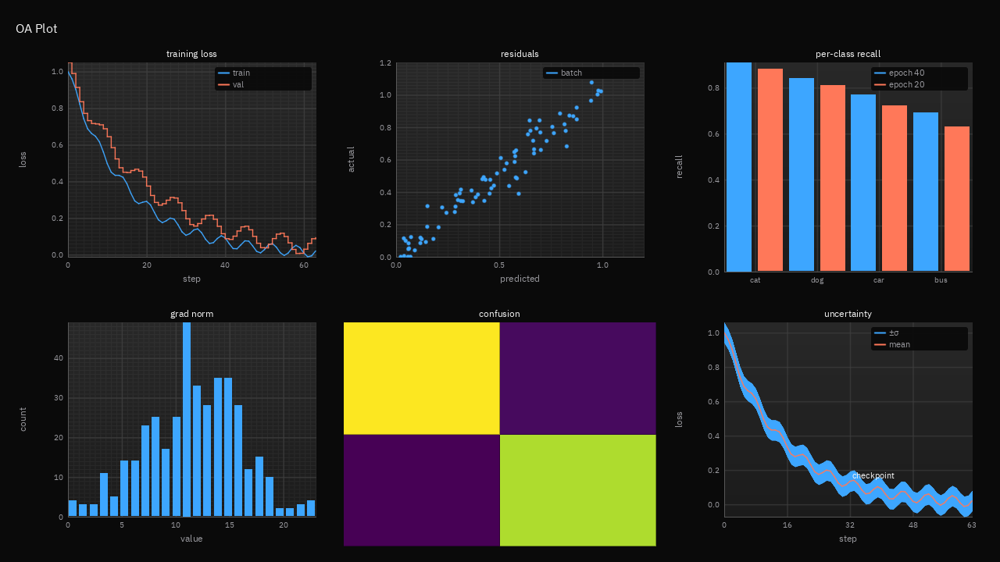

# Render a diagnostic plot gallery in Python

Compose a 2×3 `oa.plot.Figure` covering line, scatter, grouped bar, histogram, heatmap, and error-band artists, then save it to PNG or show it in a window.

## Run

```bash
python3 sdk/py/tutorials/plot/tu_plot_gallery/tu_plot_gallery.py artifact/plot/oa-plot-gallery.png
```

With an output path argument the program writes one PNG and exits. Without arguments it opens the figure in an interactive window instead.

## 1. Figure composition needs no runtime

`oa.plot.Figure` records a grid of `Axes`. Composition is pure description: no `oa.Runtime` is needed until render time.

```python
config = oa.plot.FigureConfig(title="OA Plot", rows=2, cols=3, width=1280, height=720)
figure = oa.plot.Figure(config)

axes = figure.ax(0, 0)
axes.title("training loss")
axes.x_label("step")
axes.y_label("loss")
axes.plot_xy(steps, loss, oa.plot.LineStyle(label="train"))
axes.plot_xy(steps, val, oa.plot.LineStyle(label="val", step=True))
```

## 2. Six artists, one `Axes` surface

Each panel passes python lists plus a style record:

- `axes.plot_xy` / `axes.plot` draw lines, `step=True` for stepped traces.
- `axes.scatter` draws points with a `radius`.
- `axes.bar_grouped` takes a list of series for grouped bars over `axes.categories` labels.
- `axes.histogram` bins a sample list.
- `axes.heatmap` draws a flat list as a `rows × cols` matrix.
- `axes.band` fills between two series, `axes.annotate` places a marker text, `axes.xticks` sets explicit tick positions.

```python
bars.categories(["cat", "dog", "car", "bus"])
bars.bar_grouped(
	[[0.91, 0.84, 0.77, 0.69], [0.88, 0.81, 0.72, 0.63]],
	[oa.plot.BarStyle(label="epoch 40"), oa.plot.BarStyle(label="epoch 20")],
)
stats.band(lo, hi, oa.plot.LineStyle(label="±σ"))
stats.annotate("checkpoint", 32.0, mid[32])
```

## 3. Runtime only enters at output

The runtime is built once, installed as the thread default, and passed to the output call:

```python
runtime = oa.Runtime(presentation=len(sys.argv) == 1)
oa.Runtime.set_default(runtime=runtime)
if len(sys.argv) > 1:
	figure.save_to(sys.argv[1], runtime)
else:
	figure.show(runtime=runtime)
```

`presentation=True` builds a window-capable runtime for `show`; with a path argument a compute-only runtime is enough for `save_to`.



## What you built

One `Figure` object carrying six panels replays to a PNG file or a window without rebuilding. The full source is `sdk/py/tutorials/plot/tu_plot_gallery/tu_plot_gallery.py`; the Rust version is at [walkthrough-rust](#walkthrough-rust).
