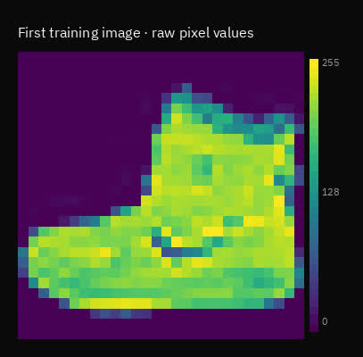
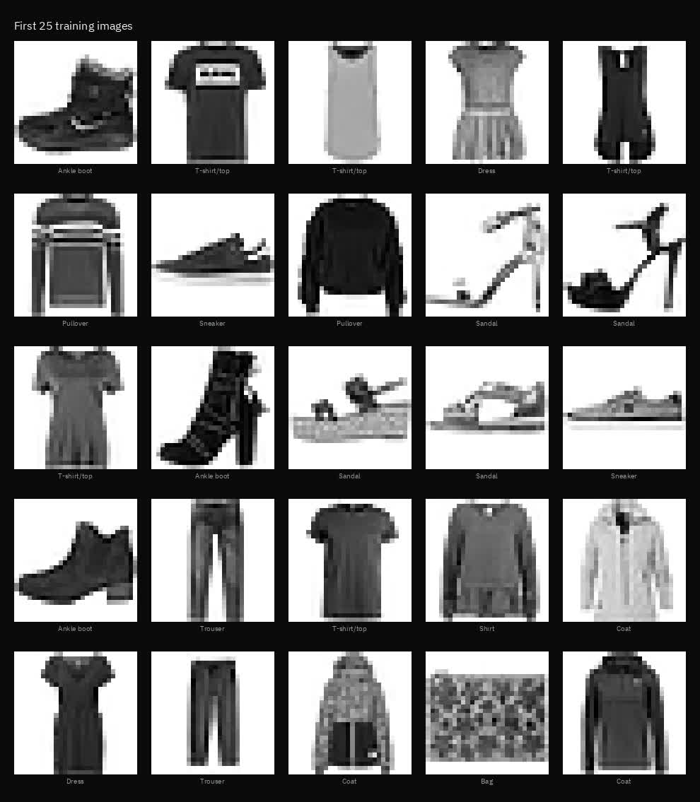
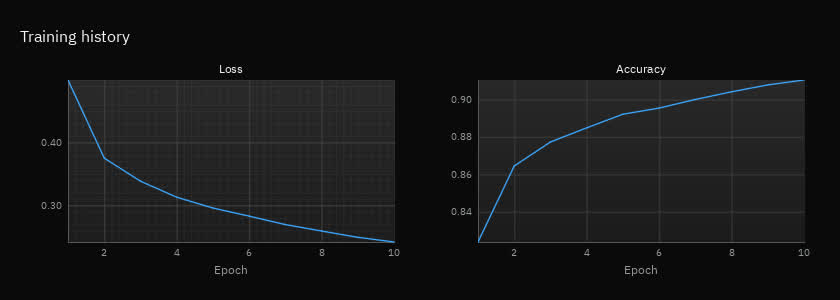
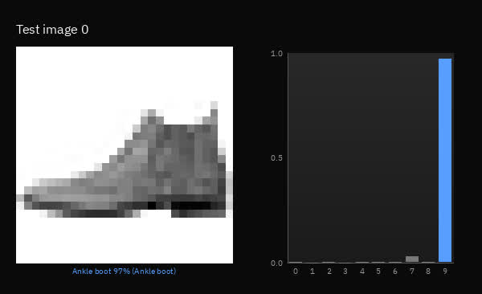
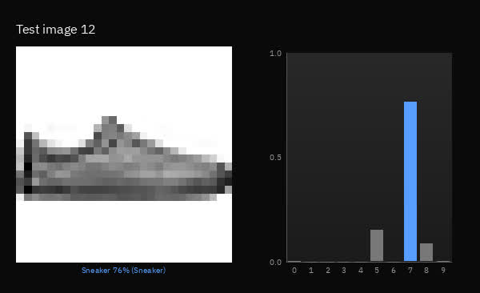
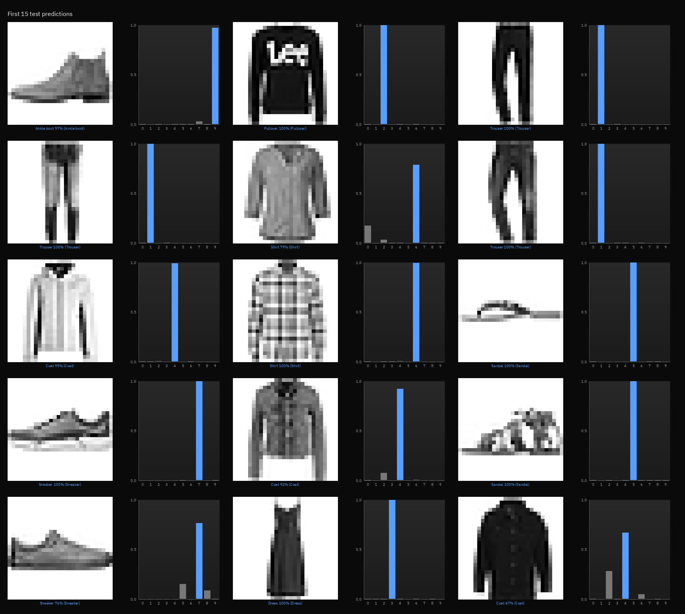
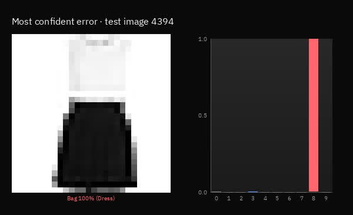
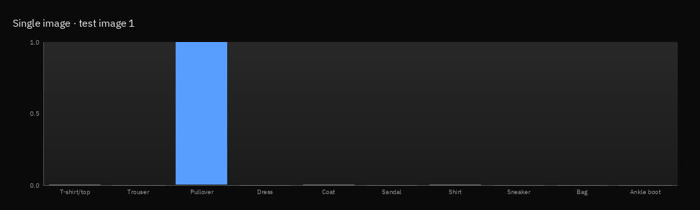

# Classify clothing with Fashion-MNIST in Rust

Train a small classifier to recognize ten kinds of clothing. This OA walkthrough
follows the experiment in TensorFlow's
[original Fashion-MNIST classification tutorial](https://www.tensorflow.org/tutorials/keras/classification).
Both programs use the official 60,000 training images and 10,000 test images,
the same model topology, and ten epochs of shuffled 32-image training batches.
The figures below were generated by the Rust run with OA 0.18.0 on Intel Iris Xe
with Mesa 26.3.1.

## Run in Rust

Run the example from the OASDK checkout.

```sh
cargo run --release --example tu_ml_fashion_mnist
```

The example writes dark-theme PNGs to `var/tutorials/fashion_mnist/rust/`.
Use `-- --epochs 1` for a shorter run or `-- --output DIR` to choose a directory.

## 1. Load and inspect the images

OADS fetches and caches the four members of the official Fashion-MNIST pack.
Use `OA_DATA_DIR` to select a shared cache. Load both splits with normalization
disabled so the first preview shows original 0–255 pixel values. OADS exposes
images as FP32 `[N, 1, 28, 28]` matrices and labels as FP32 `[N]` matrices
holding exact integer IDs. The programs check split sizes, label range, class
frequencies, and the first few sample labels before training.
[Fashion-MNIST dataset](https://github.com/zalandoresearch/fashion-mnist)

Load the raw training split on the tutorial's runtime and examine its shapes.

```rust
let data = FashionMnist::load_on(
    &runtime,
    &FashionMnistConfig {
        split: FashionMnistSplit::Train,
        normalize: false,
        ..FashionMnistConfig::default()
    },
)?;
println!("{:?} {:?}", data.images().shape(), data.labels().shape());
// [60000, 1, 28, 28] [60000]
```

The IDs in order are T-shirt/top, Trouser, Pullover, Dress, Coat, Sandal, Shirt,
Sneaker, Bag, and Ankle boot. The first training image is an ankle boot.



## 2. Scale the pixels and check the first 25 labels

Use OA's `div_scalar(255.0)` on each batch from either split to map intensities
into `[0, 1]`. Scaling in batches bounds the dispatch and avoids making a second
full device copy of the training set. The raw FP32 training split requires a
single storage buffer of about 180 MiB. The two programs compare the first
normalized image against its raw pixels and display the first 25 images with
their class names.



## 3. Build the classifier and set up training

| Layer | Output per image | Trainable values |
| --- | --- | ---: |
| Flatten | 784 pixel values | 0 |
| Linear with bias | 128 activations | 100,480 |
| ReLU | 128 activations | 0 |
| Linear with bias | 10 logits | 1,290 |

Flatten preserves the leading batch dimension. The final layer produces raw
scores for sparse cross-entropy. The programs check for four parameter tensors
and 101,770 scalar parameters. Both use OA's seeded Glorot-uniform initialization
and zero biases. OA captures AdamW updates, so both examples set weight decay
to zero for the Adam workload. The learning rate is `0.001`, the betas are
`0.9` and `0.999`, and epsilon is `1e-7`. Register the layers in `Sequential` so it runs them
in order and collects the trainable parameters for the optimizer.

```rust
let mut model = Sequential::new();
model.add(Rc::new(Flatten::new(1, -1)))?;
model.add(Rc::new(Linear::new_with_seed_on(&runtime, 784, 128, 42)?))?;
model.add(Rc::new(Relu::new()))?;
model.add(Rc::new(Linear::new_with_seed_on(&runtime, 128, 10, 43)?))?;
```

## 4. Train and evaluate

Shuffle all 60,000 training rows per epoch with OA's seeded data shuffle.
`ItTraining` runs the first step eagerly, captures the next step, and replays
the compiled command for subsequent batches. The preparation callback
uploads 32 fresh row indices. The recorded step gathers and scales those
images, converts the targets, and records forward, cross-entropy, and
backward. The iterator applies the optimizer update and waits for completion.

```rust
let mut progress = ProgressBar::default();
let mut summary = TrainingSummary::default();
let mut training = ItTraining::new(runtime, optimizer, config)?;
training.add_callback(&mut progress);
training.add_callback(&mut summary);

// record gathers the batch and returns the scalar loss after backward.
training.step(
    || Matrix::new_from_slice_on(runtime, [32], &rows),
    record,
)?;
```

The progress bar shows epoch, batch, throughput, and latest batch loss.
The programs print mean loss and accuracy at each epoch boundary. They
retain the correct-count Matrix produced during capture and read it after
each replay. Both programs check that capture succeeded and the compiled
command was reused. They report wall throughput with device timing disabled
to use the untimed command cache.

Excerpt from the Rust run with OA 0.18.0 on Intel Iris Xe.

```text
epoch 1/10
  1875/1875 |██████████| 2.26s · 1.21 ms/step · 26.51K sample/s · loss: 0.4636
  mean loss: 0.49945 · accuracy: 82.39%

…

epoch 10/10
  1875/1875 |██████████| 2.33s · 1.24 ms/step · 25.72K sample/s · loss: 0.1392
  mean loss: 0.24148 · accuracy: 91.05%

Summary:
  loss: initial 2.432920 · final 0.139209 · mean 0.312254
  Wall: 1.19 ms/step · 26.90K sample/s
  run: 22.30s · 18750 steps · batch 32
Compiled step: 15 nodes · 18749 cache hits
test: loss=0.35385 accuracy=87.90%
```

Ten epochs produce 18,750 updates. After training, process all 10,000 held-out
images, including the last 16-image batch, and report held-out loss and
accuracy. The ten-epoch run checks that training loss falls, test accuracy
reaches 85%, and test loss falls below 0.6.

| Run | Epoch 10 loss | Epoch 10 accuracy | Test loss | Test accuracy |
| --- | ---: | ---: | ---: | ---: |
| OA Rust and Python, Intel Iris Xe | 0.24148 | 91.05% | 0.35385 | 87.90% |
| TensorFlow tutorial, published run | 0.2336 | 91.37% | 0.3472 | 87.89% |

OA uses its own seeded draws and batch permutation and applies Adam epsilon
to the bias-corrected second moment. Keras uses epsilon with the uncorrected
second moment, so the same numeric settings can give different per-step
updates. [Keras Adam implementation](https://github.com/keras-team/keras/blob/master/keras/src/optimizers/adam.py)



## 5. Inspect predictions

Apply softmax to the final logits along the ten-class axis. Each of the
10,000 rows must contain ten probabilities in `[0, 1]` summing to one within
floating-point tolerance. Independently compute accuracy and mean
negative log probability for the true labels on the host and compare them
with OA's device metrics.

Inspect test rows 0 and 12 individually, then the first fifteen in a 5×3
grid. Each image caption gives the predicted class, its probability, and
the true class in parentheses. Blue captions indicate correct predictions.
Red captions indicate incorrect predictions. The bars mark the true class
in blue and a wrong predicted class in red. Since all fifteen fixed previews
can be correct, also show the highest-confidence incorrect prediction in the
test set to illustrate how this model can be confident and wrong.






In the recorded run, test image 4394 was a dress that the classifier labeled
as a bag with 99.9994% confidence.



## 6. Predict one image

Take test image 1, a pullover, and reshape it from `[28, 28]` to
`[1, 28, 28]` to include a batch axis. Run the same classifier and softmax.
The result must agree with row 1 from the full test prediction. The
single-image chart spells out all ten class names.

```rust
let image = test.slice(0, 1, 2)?.div_scalar(255.0)?.reshape([28, 28])?;
let single = image.reshape([1, 28, 28])?;
let single_scores = model.forward(&single)?.softmax(-1)?.read_f32()?;
```



## Plots and API checks

| File | Contents |
| --- | --- |
| `01_raw_image.png` | Raw training image 0 and the 0–255 color scale |
| `02_training_images.png` | First 25 labeled training images |
| `03_training_history.png` | Loss and accuracy by epoch |
| `04_prediction_00.png` | Test image 0 and its ten probabilities |
| `04_prediction_12.png` | Test image 12 and its ten probabilities |
| `05_prediction_grid.png` | First fifteen test examples and probability charts |
| `05_confident_error.png` | Highest-confidence error in the test split, if any |
| `06_single_image.png` | Class-labeled probability chart for the one-image batch |

Each `results.json` contains training history, test loss and accuracy, true
test labels, all 100,000 test probabilities, and the single-image result.
Compare matching runs on the same device:

```sh
python src/py/tutorials/ml/tu_ml_fashion_mnist/compare_runs.py
```

The comparison checks update counts, epoch and test metrics, every test
prediction and probability, and the single-image probability vector. The
recorded Rust and Python runs agreed on all 100,000 probabilities with a
maximum absolute difference of zero. Both reused the compiled command 18,749
times and matched the earlier eager Adam run on all test probabilities.

A separate one-epoch Rust run passed with the Khronos Vulkan validation
layer enabled on the same device:

```sh
VK_INSTANCE_LAYERS=VK_LAYER_KHRONOS_validation \
  cargo run --release --example tu_ml_fashion_mnist -- --epochs 1 \
  --output var/tutorials/fashion_mnist/validation
```

## Attribution

Google's original TensorFlow tutorial was last updated on 2026-11-05 UTC.
Its page content is licensed under CC BY 4.0 and its code samples under
Apache 2.0, except where the page states otherwise.
[Original tutorial](https://www.tensorflow.org/tutorials/keras/classification) ·
[CC BY 4.0](https://creativecommons.org/licenses/by/4.0/) ·
[Apache 2.0](https://www.apache.org/licenses/LICENSE-2.0) ·
[Google Developers Site Policies](https://developers.google.com/site-policies)

The figures contain samples from Fashion-MNIST by Zalando Research.
[Fashion-MNIST dataset license](../../../../../license/fashion_mnist/MIT.txt)

## Source

[Rust example](tu_ml_fashion_mnist.rs) ·
[Plot helpers](plots.rs) ·
[Full Python walkthrough](../../../../py/tutorials/ml/tu_ml_fashion_mnist/tu_ml_fashion_mnist.md)
