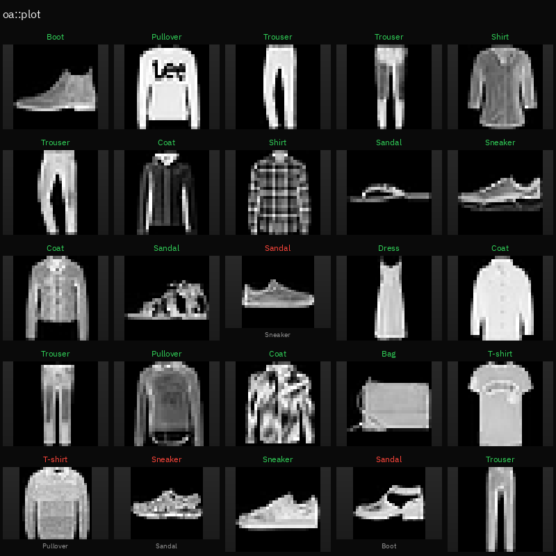

# Train a classifier and render a prediction grid in Rust

Train a small MLP on Fashion-MNIST, run inference on 25 test images, and render the results as a 5×5 `oa::plot::Figure` grid. Green titles mark correct predictions, red titles mark misses with the actual class shown as a caption.

## Run

```bash
cargo run -p sdk --release --example tu_image_grid_classify -- <data_dir> --save grid.png --steps 300
```

`<data_dir>` must contain the four Fashion-MNIST IDX files (`train-images-idx3-ubyte`, `train-labels-idx1-ubyte`, `t10k-images-idx3-ubyte`, `t10k-labels-idx1-ubyte`), defaulting to `./data/fashionMnist`. `--save` writes the grid headlessly; without it the program opens an `oa::Viewer` window. `--steps` sets the training step count (default 2000).

Expected output:

```
Loaded 60000 train / 10000 test images
epoch 1/1
  300/300 |██████████| 0.57s · 1.91 ms/step · 33.43K sample/s · loss: 0.3941

Summary:
  loss: initial 2.332655 · final 0.394115 · mean 0.642502
  Wall: 1.91 ms/step · 33.42K sample/s
  run: 0.57s · 300 steps · batch 64
Training done.
Prediction grid: 21 / 25 correct on the first 25 test images
Saved: grid.png
```



## 1. Load the IDX dataset

`load_mnist_idx` reads the IDX containers directly: it validates the magic headers (`0x0803` images, `0x0801` labels), checks the 28×28 geometry, and keeps the raw `u8` buffers. Raw pixel bytes are needed twice, once normalized to `f32` for training and once verbatim for the tile textures.

## 2. A two-layer MLP as a `Module`

`MnistClassifier` composes `784 → Relu(128) → 10` and registers its `Linear` layers in a `ModuleRegistry` so `all_parameters` can enumerate the weights for the optimizer.

```rust
impl Module for MnistClassifier {
	fn forward(&self, input: &Matrix) -> oa::Result<Matrix> {
		let h = self.fc1.forward(input)?;
		let h = self.relu.forward(&h)?;
		self.fc2.forward(&h)
	}

	fn registry(&self) -> &ModuleRegistry {
		&self.registry
	}
}
```

## 3. `ItTraining` drives the loop

Training is AdamW at lr 0.001 through `ItTraining` with the usual observers: `LossMetric`, `ProgressBar`, `TrainingSummary`. The data closure slices 64-image windows out of the training set and uploads them as `Matrix` batches; the step closure runs the forward pass under a `GradientTape` and backpropagates the cross-entropy loss.

```rust
let mut optimizer = oa::ml::AdamW::new(params, 0.001)?;
let mut training = ItTraining::new(runtime, &mut optimizer, ItTrainingConfig {
	total_steps: train_steps,
	steps_per_epoch,
	batch_size: BATCH as u64,
	timer_name: "image_grid_classify_step".into(),
	..ItTrainingConfig::default()
})?;
training.add_metric(&mut loss_metric);
training.add_callback(&mut progress);
training.add_callback(&mut summary);
```

## 4. Inference produces tiles, not numbers

The first 25 test images go through `model.forward`, `oa::matrix::softmax`, and a host readback. Each argmax result pairs with an RGBA8 texture built from the raw grayscale bytes:

```rust
let probs = oa::matrix::softmax(&logits, -1)?;
let host_probs = probs.read_f32()?;
// per image: argmax over the class row
let tile = oa::render::texture_from_rgba8(&rgba, 28, 28)?;
```

## 5. `imshow` plus colored titles fill the grid

`populate_figure` assigns one `Axes` cell per image. `ax.imshow` draws the texture; `title_color` carries the predicted class in green or red, and misses add the actual class as a muted `caption_color`.

```rust
ax.imshow(cell.tile.clone());
if cell.correct {
	ax.title_color(CLASSES[cell.predicted], color_success());
} else {
	ax.title_color(CLASSES[cell.predicted], color_error());
	ax.caption_color(CLASSES[cell.actual], color_muted());
}
ax.grid(false);
ax.legend(false);
```

## 6. Two sinks, one figure

`--save` mode runs everything on `Runtime::current()` and calls `fig.save_to(path)`. Interactive mode wraps the same pipeline in `ImageGridClassifySource`, a `ViewerLiveSource` whose `open` trains and fills the figure and whose `render` draws `fig.render_frame` each frame, driven by `oa::Viewer` on a presentation runtime built from the SDL window's required extensions.

## What you built

End-to-end GPU pipeline: raw IDX bytes to trained MLP to a composited prediction grid, with the same figure renderable headlessly or in a live window. The full source is `sdk/rs/tutorials/plot/tu_image_grid_classify/tu_image_grid_classify.rs`. The same `ItTraining` workflow on a smaller model is on the MNIST tutorial page.
