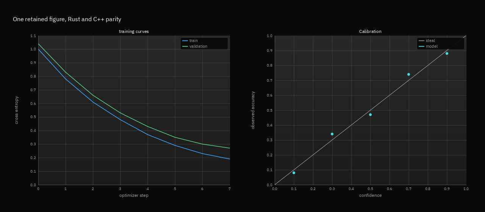
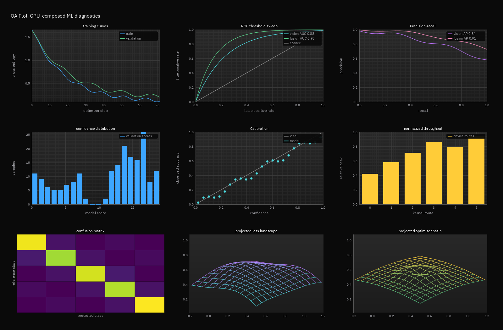
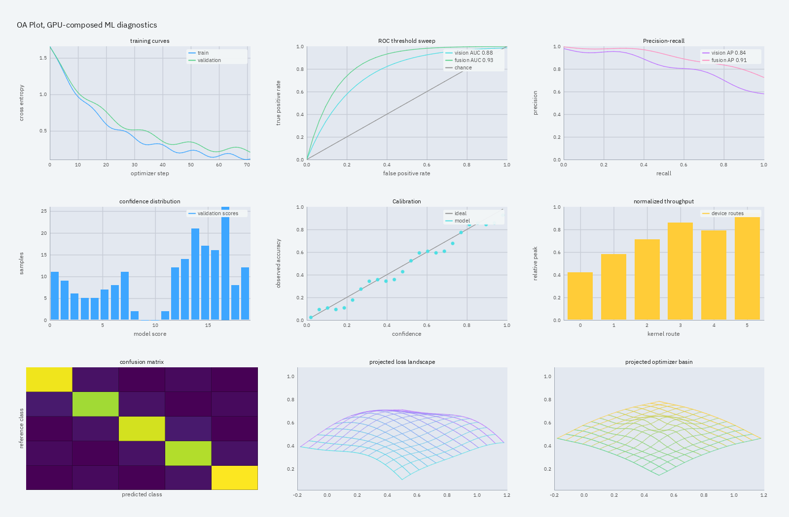

# Render a diagnostic plot gallery in Rust

Compose nine diagnostic panels into one retained `oa::plot::Figure`, render it on the GPU compositor, and replay the same figure to a PNG file or an interactive `oa::Viewer` window.

## Run

```bash
cargo run -p sdk --release --example tu_plot_gallery -- --headless --output artifact/plot
```

`--headless` skips the window and only writes PNG artifacts. Without it the program additionally opens the dark gallery in an `oa::Viewer` window. `--output DIR` chooses where the files land.

Expected output:

```
OA Plot walkthrough artifacts:
  artifact/plot/oa-plot-intro-dark.png
  artifact/plot/oa-plot-gallery-dark.png
  artifact/plot/oa-plot-gallery-light.png
  artifact/plot/oa-plot-evaluation-dark.png
  artifact/plot/oa-plot-diagnostics-dark.png
  artifact/plot/oa-plot-landscapes-dark.png
```

## 1. A figure is a grid of axes

`Figure::new` takes a `FigureConfig` describing the grid, canvas size, spacing, and theme. `fig.ax(row, col)` returns a mutable `Axes` handle for each cell.

```rust
let mut fig = oa::plot::Figure::new(FigureConfig {
	title: "oa::plot intro".to_owned(),
	rows: 1,
	cols: 2,
	width: 1280,
	height: 560,
	h_spacing: 36,
	padding: 34,
	theme: Theme::Dark,
	..Default::default()
});
fig.title("One retained figure, Rust and C++ parity");

let curves = fig.ax(0, 0);
curves.title("training curves");
curves.x_label("optimizer step");
curves.y_label("cross entropy");
curves.limits(0.0, 7.0, 0.0, 1.1);
```

The figure is retained: drawing calls only record a description. Nothing renders until `save_to` or `show` replays it.



## 2. Artists share one `Axes`

Every panel uses the same call shape: pass data slices plus a style record.

- `ax.plot(&y, LineStyle)` and `ax.plot_xy(&x, &y, LineStyle)` draw lines.
- `ax.scatter(&x, &y, ScatterStyle)` draws points.
- `ax.histogram(&values, bins, BarStyle)` bins samples.
- `ax.bar(&values, BarStyle)` draws bars.
- `ax.heatmap(&values, rows, cols, HeatmapStyle)` draws a matrix.

```rust
ax.plot_xy(&rate, &fusion, line(success(), "fusion AUC 0.93", 1.35, 4));
ax.histogram(&scores, 20, bars(accent(), "validation scores", 0.20));
ax.heatmap(&confusion, 5, 5, HeatmapStyle {
	colormap: 1,
	auto_scale: true,
	show_grid: true,
	..Default::default()
});
```

Legends come from the `label` field on each style. `ax.legend(false)` and `ax.grid(false)` turn the defaults off per axes.

## 3. Wireframes are explicit-X projections

The two landscape panels are 2D projections of scalar fields, not a 3D scene API. Each mesh line is a row or column sweep evaluated through a height function and projected into axes space, then drawn with `plot_xy`. Color interpolates between a `near` and `far` color along the sweep.

```rust
for row in 0..LINES {
	let v = -1.0 + 2.0 * row as f32 / (LINES - 1) as f32;
	// sample height_fn along the row, project into the axes plane
	let t = row as f32 / (LINES - 1) as f32;
	ax.plot_xy(&px, &py, line(gradient(far, near, t), "", 1.15, 8));
}
```

## 4. One figure, two output sinks

`gallery(theme)` fills a 3×3 `Figure` by calling each panel builder on a cell:

```rust
fn gallery(theme: Theme) -> oa::plot::Figure {
	let mut fig = oa::plot::Figure::new(FigureConfig {
		rows: 3, cols: 3, width: 1600, height: 1050, theme,
		..Default::default()
	});
	training_plot(fig.ax(0, 0));
	roc_plot(fig.ax(0, 1));
	// ...
	fig
}
```

`fig.save_to(path)` renders to PNG through the compute-only runtime. `fig.show()` needs a presentation runtime, so `main` builds the runtime to match the mode:

```rust
let runtime = if show {
	let window = oa::SdlWindow::new("OA Plot presentation probe", 1, 1)?;
	let extensions = window.required_instance_extensions()?;
	Runtime::builder()
		.requirements(oa::RuntimeRequirements::default().presentation())
		.instance_extensions(extensions)
		.build()?
} else {
	Runtime::current()?
};
Runtime::set_default(runtime.clone());
```

In `--headless` mode `Runtime::current()` resolves the thread default compute runtime. In show mode the builder adds the `presentation` requirement and the instance extensions the SDL window needs, and `set_default` installs it for the figure and texture calls.




## What you built

A retained `Figure` records every panel once and replays it to PNG or to `oa::Viewer` with the same rendering path. The full source is `sdk/rs/tutorials/plot/tu_plot_gallery/tu_plot_gallery.rs`; the Python version is at [walkthrough-python](#walkthrough-python).
